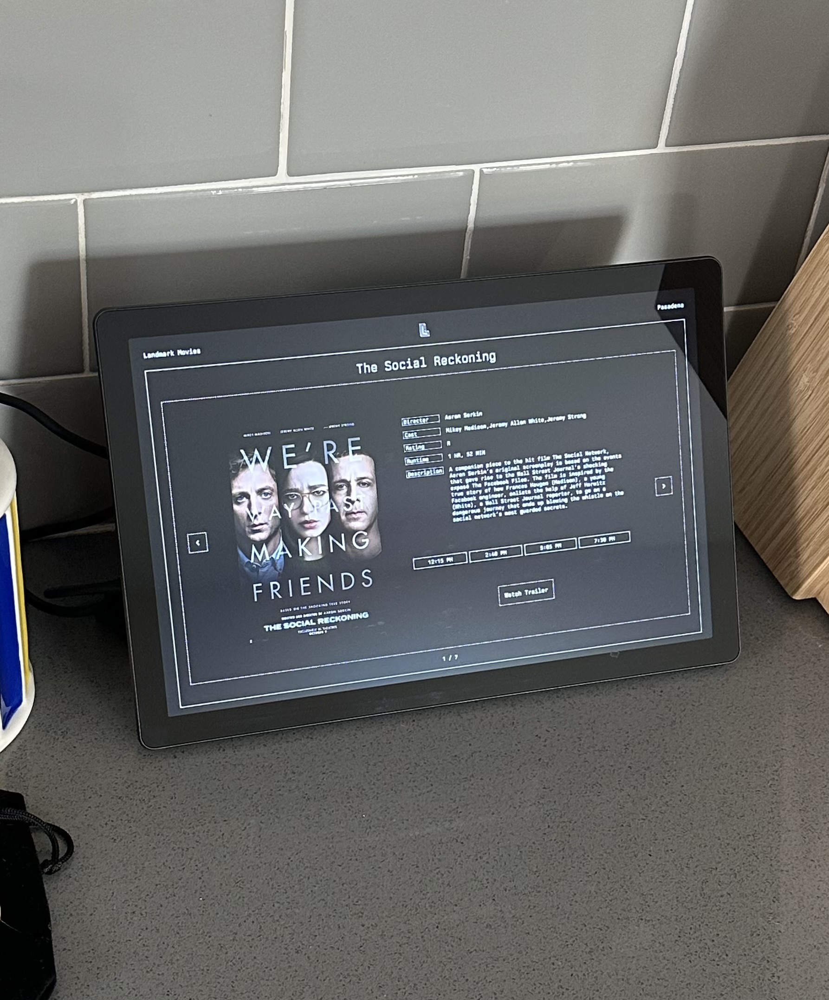

# Landmark

A desktop application built in Wails3 to display current movies and showtimes at Landmark theaters

## Stack

- Go
- Wails3
- Typescript
- Svelte

## Getting Started

_**Assuming Go is installed**_

Install latest Wails3 version

```bash
go install github.com/wailsapp/wails/v3/cmd/wails3@latest
```

Copy .env.template

```bash
cp .env.template .env
```

Package the executable

```bash
wails3 package
```

Run the executable

```bash
./bin/landmark
```

## Why?

My wife and I go to this theater a lot and I wanted a convenient way to see show times.
I had a Pi 5 laying around, bought a 10 inch touchscreen, and cross compiled the application for the Pi.

This 'kiosk' current lives in my kitchen so I can easily see what movies are playing at our favorite theater.


